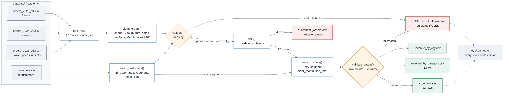

# pipeline_shop: a reproducible, validated order pipeline

Lab 3.3 home exercise, **Data Management**, Chapter 3 (Reproducible & Validated Data Pipelines), SRH University Heidelberg.
Built on the course starter `shop_pipeline`. It turns raw online-shop order files into trusted, documented outputs with **one command**.

**Group:** Data-Managers

| Member |
|---|
| Utkarsh Anil Gaigole |
| Aditya Sanjay Pawar |
| Sreelakshmi Koyambrath Sivaraman |
| Akshay Anilkumar Sreedevi |

## What we added (Lab 3.3)

| Area | Change |
|---|---|
| New output | `data/output/revenue_by_category.csv`: orders, items, revenue and share of revenue per category |
| New rules | 4 new input rules, including a **custom** "order date not in the future" check, plus an **output check** (custom table-level rule `line_total = quantity × unit_price` and a row-count reconciliation) |
| Lab 3.2 rules | `email` (warning only) and `country` (stop), with the decisions implemented: bad email is flagged, the known typo `Germny` is fixed in cleaning |
| New columns | `fct_orders`: `segment`, `order_month` · customers (internal): `email_flag` |
| Lineage | [`docs/lineage.png`](docs/lineage.png) (source: [`docs/lineage.mmd`](docs/lineage.mmd)) |
| Run log | every run logs the git commit of the code (`Code version: …`) |
| Tests | `tests/test_rules.py`: 10 tests, one bad value per rule |
| Cleaning log | [`CLEANING_LOG.md`](CLEANING_LOG.md) |

## Setup and run

```bash
cd pipeline_shop
python -m venv .venv
source .venv/bin/activate        # Windows: .venv\Scripts\activate
pip install -r requirements.txt
python pipeline.py               # run the pipeline
python -m pytest -q              # optional: prove that every rule fires
```

Expected log (abridged):

```
Loaded 17 order rows from 3 files, 9 customers
Removed 1 exact duplicate(s): 17 -> 16 rows
Price correction: 3 row(s) from orders_2026_03.csv divided by 100 (cents -> EUR)
Fixed country typo for C007: Germny -> Germany
Email flagged (kept): C003 invalid, C008 missing
Validation passed: all critical rules OK
Split: 12 trusted, 4 quarantined
Output check passed: 12 + 4 = 16 rows, fct_orders rules OK
Revenue: EUR 4,015
By category: Electronics EUR 3,782.59 (94.2%), Accessories EUR 232.41 (5.8%)
```

Run it again: you get the same result and byte-identical output files. Every run appends a block to `logs/run_log.txt`.
**Check the log before using the outputs:** a failed run writes nothing, so the files in `data/output/` are then still those of the last *successful* run.

## Project structure

```
pipeline_shop/
├── README.md            this file: how to run, lineage, rules, data dictionary
├── CLEANING_LOG.md      what changed in the data and in the pipeline, and why
├── requirements.txt     pandas, pandera, pytest
├── pipeline.py          the steps: load → clean → validate → split → enrich → check → output
├── rules.py             validation rules (pandera): input rules + output rules
├── tests/test_rules.py  one test per rule
├── docs/
│   ├── lineage.mmd      lineage drawing (Mermaid source, renders on GitHub)
│   ├── lineage.png      lineage drawing (image)
│   └── lineage.svg
├── data/
│   ├── raw/             files exactly as received: read, never written
│   └── output/          trusted outputs (created by the pipeline)
├── logs/
│   └── run_log.txt      what happened on every run
└── extras/
    └── orders_2026_04.csv   April file: used to test the STOP path (Lab 3.2)
```

Data flows one way: **raw → clean → output**. Never backwards, never overwriting raw.

## Lineage



Raw files → `load_raw()` adds `source_file` → `clean_orders()` / `clean_customers()` → `validate()` (stop or continue) → `split()` (quarantine with a reason) → `enrich_orders()` → `validate_output()` → four output files. Every run is logged with the code version, so each output can be traced to its input files (`source_file`) **and** the code that produced it.

## Inputs (`data/raw/`)

| File | Contents |
|---|---|
| `orders_2026_01.csv`, `orders_2026_02.csv`, `orders_2026_03.csv` | Monthly order exports: order_id, order_date, customer_id, category, quantity, unit_price. **March stores prices in cents.** |
| `customers.csv` | Customer master: customer_id, customer_name, city, country, email, segment |

## Steps (`pipeline.py`)

| Step | Function | What it does |
|---|---|---|
| Load | `load_raw()` | Reads every `orders_*.csv` as text and adds `source_file` (start of lineage) |
| Clean | `clean_orders()` | Removes exact duplicates, trims text, parses mixed date formats, converts numbers, **divides prices of `CENTS_FILES` by 100** |
| Clean | `clean_customers()` | Trims text, **fixes known country typos**, **adds `email_flag`** |
| Validate | `validate()` | Runs the input rules in `rules.py`. Stop rule broken → stop, write nothing. Warning rule → logged only |
| Split | `split()` | Row-level problems → **quarantine with a reason** |
| Enrich | `enrich_orders()` | Adds the customer's `city` and `segment`, `order_month` and `line_total` |
| Check | `validate_output()` | **New.** Reconciles row counts and runs the output rules on `fct_orders`. Any problem → stop, write nothing |
| Output | `output()` | Writes the four output files and the revenue to the run log |

## Rules

Three levels: **STOP** (the whole table is unusable → no outputs), **WARN** (logged and flagged, run continues), **QUARANTINE** (one row is unusable → held back with a reason).

| # | Rule | Where | Level | Chapter 2 dimension |
|---|---|---|---|---|
| 1 | `order_id` unique, not empty, pattern `^[A-Z]\d{3}$` | `rules.py` orders | STOP | Uniqueness · Completeness · Validity |
| 2 | `category` in Accessories, Electronics | `rules.py` orders | STOP | Validity (allowed values) |
| 3 | `unit_price` ≥ 0 | `rules.py` orders | STOP | Validity (range) |
| 4 | **NEW (custom):** `order_date` not in the future | `rules.py` orders, `not_in_future()` | STOP | Timeliness / Accuracy |
| 5 | **NEW:** `unit_price` ≤ EUR 2,000 | `rules.py` orders | STOP | Accuracy (plausibility); catches prices in cents |
| 6 | **NEW:** `customer_id` pattern `^C\d{3}$` in orders | `rules.py` orders | STOP | Validity (format), Consistency with the master |
| 7 | `customer_id` unique, pattern `^C\d{3}$`; name and city not empty | `rules.py` customers | STOP | Uniqueness · Validity · Completeness |
| 8 | `email` is `name@domain.tld` or empty (Lab 3.2) | `rules.py` customers | **WARN** → `email_flag` | Validity (format) |
| 9 | `country` in Germany, Austria, Switzerland (Lab 3.2) | `rules.py` customers | STOP (after typo fix) | Validity (allowed values) |
| 10 | **NEW:** `segment` in Private, Business | `rules.py` customers | STOP | Validity (allowed values) |
| 11 | **NEW (custom, output):** `line_total = quantity × unit_price`; quantity > 0; city and segment present; `order_month` YYYY-MM | `rules.py` `fct_orders_rules` | STOP | Accuracy · Completeness |
| 12 | **NEW (output):** trusted + quarantined = rows after dedup; enrich keeps the row count | `pipeline.validate_output()` | STOP | Completeness (no row lost or duplicated) |
| 13 | quantity ≤ 0, missing price, missing date, unknown customer | `pipeline.split()` | QUARANTINE | Validity · Completeness · Consistency |

Rule 4 compares with the date of the run, so it is the only rule whose result could change over time. For our historical data (Jan–Mar 2026) it is stable.

## Outputs (`data/output/`): data dictionary

**`fct_orders.csv`**: trusted orders, ready for analysis (12 rows)

| Column | Meaning | Unit / rule |
|---|---|---|
| order_id | Order identifier | one capital letter + 3 digits, unique |
| order_date | Date of the order | YYYY-MM-DD, not in the future |
| customer_id | Customer identifier | `C` + 3 digits, must exist in customers.csv |
| category | Product category | Accessories or Electronics |
| quantity | Items ordered | > 0 |
| unit_price | Price per item | EUR, 0–2,000 (March converted from cents) |
| source_file | Raw file the row came from | lineage |
| city | Customer's city | from customers.csv, never empty |
| **segment** | **Customer segment (new)** | **from customers.csv: Private or Business** |
| **order_month** | **Month of the order (new)** | **YYYY-MM, derived from order_date** |
| line_total | Revenue of the order line | quantity × unit_price, EUR, rounded to cents |

**`quarantine_orders.csv`**: rows held back (4 rows): the cleaned order columns plus `reason` (`quantity <= 0`, `unknown customer`, `missing unit_price`, `missing order_date`).

**`revenue_by_city.csv`**: business summary: `city`, `line_total` (sum, EUR).

**`revenue_by_category.csv`** (new): business summary per category

| Column | Meaning | Unit / rule |
|---|---|---|
| category | Product category | Accessories or Electronics |
| orders | Number of trusted orders | distinct order_id |
| quantity | Items sold | sum of quantity |
| line_total | Revenue | sum of line_total, EUR |
| share_pct | Share of total revenue | percent, 1 decimal; all rows add up to 100 |

**Internal column (not written to a file):** `customers.email_flag`: `ok`, `missing` or `invalid`, set in `clean_customers()`.

## Adding a new month

Copy the export into `data/raw/` and run `python pipeline.py`. If the file breaks a STOP rule, the log lists rule, value and row, and nothing is written. Fix the source, never the raw file in place. If the new file stores prices in cents, add it to `CENTS_FILES` in `pipeline.py` (rule 5 will remind you).

## Reproducibility notes

- Same inputs + same code → same outputs; the code version is in every log block.
- Package versions are minimum versions (`>=`). Tested with Python 3.13, pandas 3.1, pandera 0.35.
- `data/raw/` is never written; results only go to `data/output/` and `logs/`.
